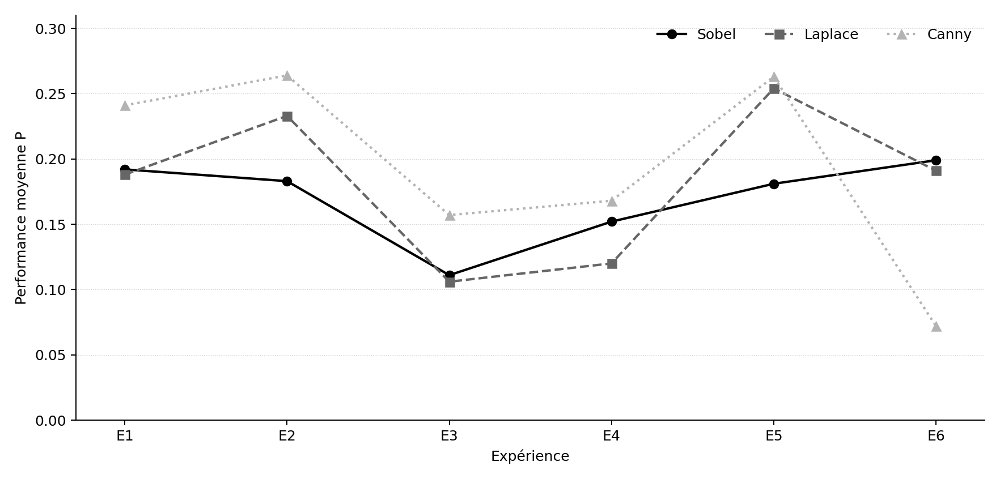
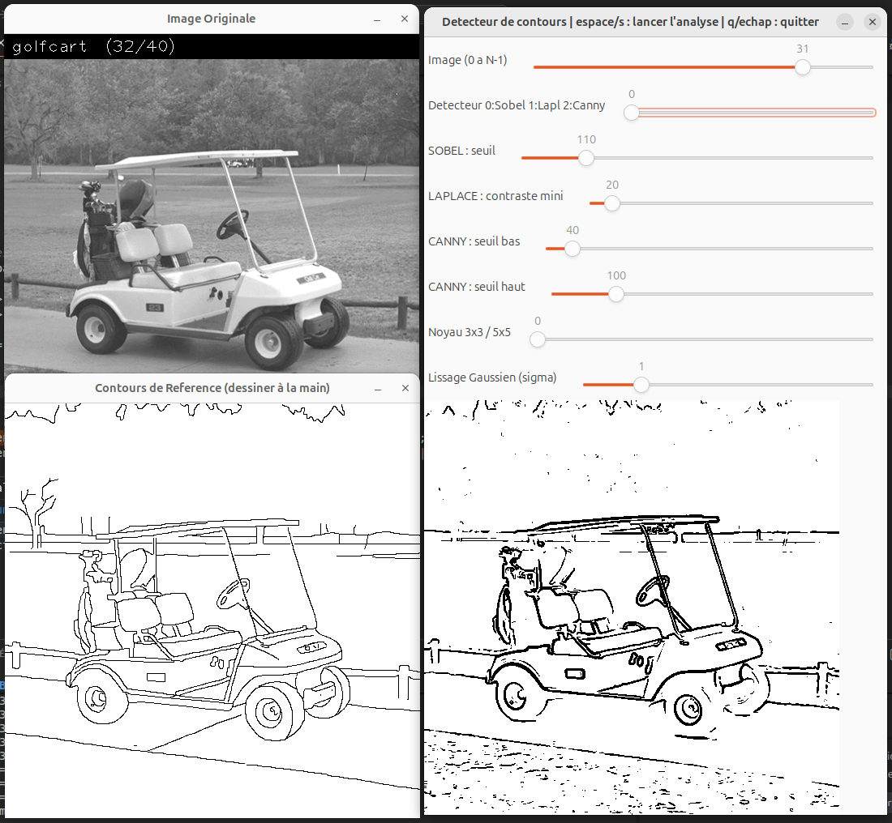
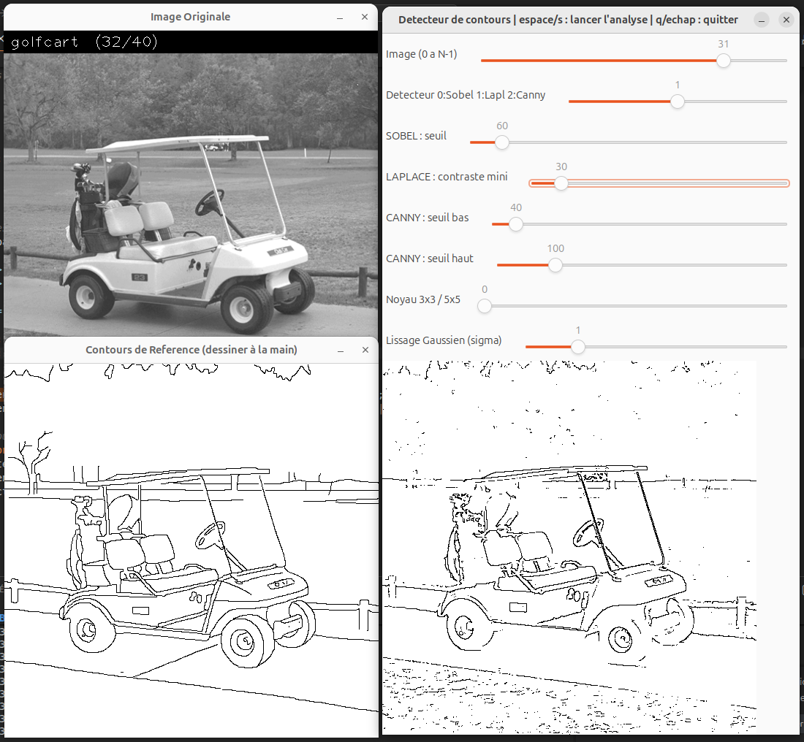
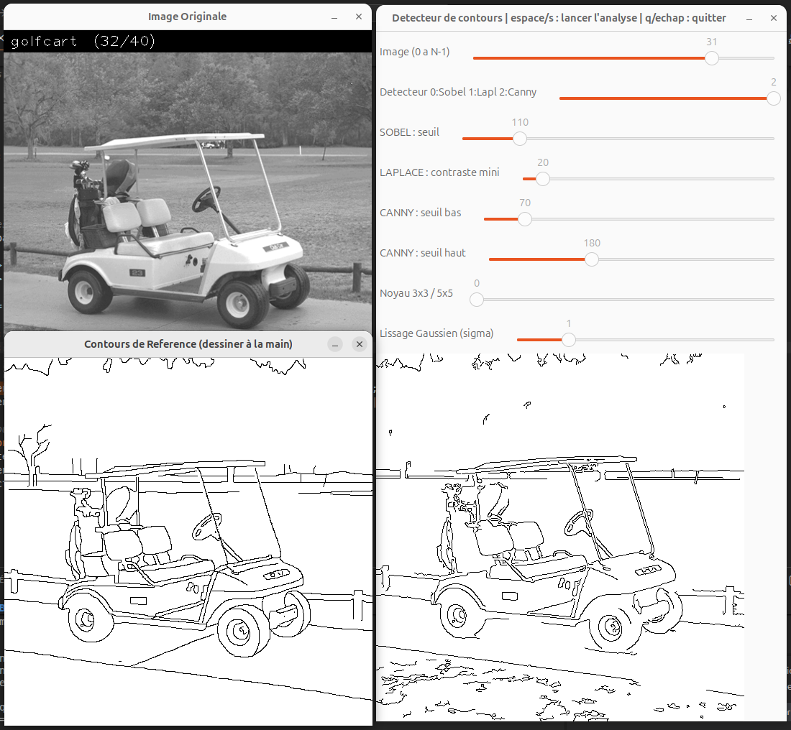

# Détection et évaluation de contours avec OpenCV

Compte rendu de TP - Traitement d'images  
Polytech Marseille - Octobre 2026

## 1. Introduction

L'objectif de ce TP est de détecter les contours d'une image, puis de comparer le résultat à une référence dessinée à la main. On a travaillé en C++ avec OpenCV sur trois méthodes : Sobel, Laplace et Canny. Elles ne repèrent pas les contours de la même manière et, surtout, elles ne donnent pas forcément le même résultat avec des réglages différents.

On a réalisé un programme qui affiche l'image originale, ses contours de référence et les contours calculés. Des curseurs (*trackbars*) permettent de choisir le détecteur, de modifier ses seuils, la taille du noyau et le lissage, sans avoir à recompiler. On peut ensuite lancer le traitement des 40 images du jeu de données et calculer les performances de chaque méthode.

On a effectué six séries de mesures, soit 720 évaluations au total. Le but est de comprendre l'effet des principaux paramètres, et pas seulement de regarder si une image de contours paraît correcte.

## 2. Les trois méthodes de détection

### 2.1. Sobel

Sobel repose sur les dérivées premières : on recherche les variations d'intensité selon les deux directions de l'image. Avec un noyau 3x3, les masques utilisés sont :

$$
K_x=\begin{pmatrix}-1&0&1\\-2&0&2\\-1&0&1\end{pmatrix}
\qquad
K_y=\begin{pmatrix}-1&-2&-1\\0&0&0\\1&2&1\end{pmatrix}.
$$

Après convolution, on obtient les gradients $G_x$ et $G_y$. On calcule leur norme et leur direction :

$$
G=\sqrt{G_x^2+G_y^2},\qquad
\theta=\operatorname{atan2}(G_y,G_x).
$$

La norme indique l'importance de la variation d'intensité. Dans notre programme, on conserve les pixels pour lesquels cette norme dépasse un seuil choisi avec une trackbar. La direction est calculée, mais elle n'est pas utilisée pour affiner les contours.

La classe *EdgeDetector* du cours s'appuie sur *cv::Sobel*. L'image d'entrée et la matrice de sortie sont fournies à la fonction ; *CV_32F* permet de conserver les dérivées négatives, les ordres de dérivation *(dx, dy)* valent *(1, 0)* ou *(0, 1)* et le dernier paramètre fixe le noyau à 3 ou 5. *cv::cartToPolar* calcule ensuite la norme et l'orientation. La méthode *getBinaryMap* applique le seuil.

Quand on utilise un noyau 5x5, les amplitudes du gradient changent. Dans le code, on multiplie alors le seuil de Sobel par 16 pour compenser approximativement cette différence d'échelle. Ce facteur est un choix pratique : il ne garantit pas que les deux noyaux soient comparables avec exactement la même sensibilité.

### 2.2. Laplace

Le Laplacien utilise cette fois les dérivées secondes :

$$
\Delta I=\frac{\partial^2 I}{\partial x^2}+\frac{\partial^2 I}{\partial y^2}.
$$

Pour le noyau 3x3 utilisé par *cv::Laplacian*, le masque correspondant, à l'échelle par défaut, est :

$$
K_L=\begin{pmatrix}2&0&2\\0&-8&0\\2&0&2\end{pmatrix}.
$$

Plutôt que de garder uniquement les grandes valeurs du Laplacien, on recherche ses passages par zéro, c'est-à-dire les endroits où son signe change. La classe *LaplacianZC* calcule le Laplacien avec *cv::Laplacian(image, sortie, CV_32F, noyau)*. Ensuite, *getZeroCrossings* sépare les valeurs positives et négatives, dilate la zone positive et récupère les pixels situés à sa frontière.

On obtenait ainsi beaucoup de petits contours. Dans notre programme, on filtre donc les passages par zéro avec un masque de contraste local. Ce contraste est calculé à partir du gradient morphologique, c'est-à-dire la différence entre la dilatation et l'érosion de l'image. Seuls les passages par zéro dont le contraste dépasse le seuil choisi sont conservés. Le curseur « contraste mini » de Laplace ne règle donc pas directement une valeur du Laplacien.

### 2.3. Canny

Canny réunit plusieurs traitements. On commence par réduire les détails fins avec un filtre gaussien lorsque le lissage est activé. Les coefficients de ce filtre dépendent de la distance au centre et de $\sigma$ :

$$
G_\sigma(x,y)=\frac{1}{2\pi\sigma^2}\exp\!\left(-\frac{x^2+y^2}{2\sigma^2}\right).
$$

Dans notre code, le noyau de lissage a pour taille $(2\sigma+1)\times(2\sigma+1)$ : 3x3 si $\sigma=1$, 5x5 si $\sigma=2$. Pour $\sigma=0$, on désactive ce lissage préalable.

Canny calcule ensuite un gradient et sa direction. Il applique une suppression des non-maxima : pour chaque pixel, il compare la réponse avec celles des voisins situés dans la direction du gradient. Si le pixel n'est pas un maximum local, il est écarté. On obtient ainsi des contours plus fins qu'avec notre version de Sobel, qui se limite à un seuillage.

Enfin, Canny utilise deux seuils. Au-dessus du seuil haut, on considère le contour comme fort. Entre les deux seuils, un pixel n'est retenu que s'il est relié à un contour fort : c'est le suivi par hystérésis. Sous le seuil bas, il est supprimé.

On utilise directement *cv::Canny(image, contours, seuilBas, seuilHaut, noyau)*, plutôt que de reprogrammer ces étapes. Les deux seuils et la taille du noyau interne, 3 ou 5, sont reliés aux trackbars. Le paramètre facultatif *L2gradient* reste à sa valeur par défaut (*false*) : OpenCV utilise alors $|G_x|+|G_y|$ pour la norme du gradient interne, et non la norme euclidienne. Le lissage du programme est effectué avant l'appel à Canny.

## 3. Fonctions OpenCV et interface

En dehors des trois détecteurs, on utilise quelques fonctions pour préparer les images. *cv::glob* récupère les fichiers des dossiers *ref/im/* et *ref/gt/* ; on les associe grâce à leur nom, puis *cv::imread* les charge en niveaux de gris. Les cartes produites sont enregistrées avec *cv::imwrite* dans *resultats/sobel/*, *resultats/laplace/* et *resultats/canny/*.

Le lissage est réalisé par *cv::GaussianBlur*, avec l'image d'entrée, l'image de sortie, la taille du filtre et $\sigma$. Pour filtrer Laplace, on combine *cv::morphologyEx* avec l'opération *MORPH_GRADIENT*, *cv::threshold* pour produire un masque binaire et *cv::bitwise_and* pour ne conserver que les pixels présents à la fois dans ce masque et dans les passages par zéro. *cv::threshold* sert aussi à binariser les références, avec le seuil 127.

L'interface repose sur *cv::namedWindow* et *cv::imshow*. Avec *cv::createTrackbar(nom, fenêtre, variable, maximum, rappel)*, chaque curseur modifie une variable du programme. La fonction de rappel *mettreAJourAffichage* recalcule immédiatement les contours lorsque l'on change un réglage. On peut donc tester plusieurs paramètres sur une même image avant de lancer le traitement complet. *cv::waitKey* permet enfin de démarrer les mesures avec Espace ou S, ou de quitter avec Q ou Échap.

## 4. Méthode d'évaluation

Chaque image de 512x512 pixels possède une image de référence contenant des contours tracés manuellement. On transforme d'abord cette référence en image binaire. Dans les calculs, un pixel blanc représente un contour, aussi bien pour la référence que pour la détection.

On ne compare pas seulement les pixels aux mêmes coordonnées. Un contour peut être correctement placé tout en étant décalé d'un pixel. On recherche donc d'abord les correspondances exactes, puis celles présentes dans le voisinage 3x3 des pixels restants, soit une tolérance d'un pixel horizontalement, verticalement ou en diagonale. Deux masques mémorisent les pixels déjà associés pour éviter qu'un même pixel soit compté deux fois. Cette méthode donne la priorité aux correspondances exactes ; la recherche des autres correspondances dépend ensuite de l'ordre de parcours.

On relève cinq grandeurs pour chaque image :

| Symbole | Signification |
|---|---|
| $D$ | Nombre de pixels de contour détectés |
| $R$ | Nombre de pixels de contour dans la référence |
| $C$ | Nombre de correspondances correctes |
| $FP$ | Faux positifs : $D-C$ |
| $FN$ | Faux négatifs : $R-C$ |

Le programme calcule trois indicateurs en prenant le même dénominateur $N=C+FP+FN$ :

$$
P=\frac{C}{N},\qquad TFP=\frac{FP}{N},\qquad TFN=\frac{FN}{N}.
$$

On cherche à avoir une performance $P$ élevée, avec un TFP et un TFN faibles. La somme des trois vaut 1 lorsque $N>0$. Il s'agit des définitions retenues pour ce TP ; les taux de faux positifs et de faux négatifs statistiques habituels utilisent d'autres dénominateurs.

Par exemple, pour l'image *golfcart* avec Canny et les réglages initiaux, on a $D=11\,729$, $R=11\,409$ et $C=7\,644$. On obtient donc $FP=4\,085$ et $FN=3\,765$, puis $P=0{,}493$, $TFP=0{,}264$ et $TFN=0{,}243$.

On répète le calcul pour les 40 images et on prend la moyenne des 40 valeurs de chaque indicateur : toutes les images ont ainsi le même poids. On donne aussi l'écart-type de $P$, calculé sur ces 40 valeurs, pour montrer que les performances varient selon les images. Les mesures individuelles et les formules du tableur figurent dans *annexes/mesures.xlsx*.

## 5. Protocole expérimental

On a réalisé six expériences en appliquant chaque fois les trois méthodes aux 40 images, soit $6\times3\times40=720$ évaluations. Les images de référence et la méthode d'évaluation restent identiques. Dans les expériences 2 et 3, on modifie les seuils ; dans les expériences 4 à 6, on revient aux seuils initiaux et on change seulement le lissage ou le noyau.

| Exp. | Réglage testé | Seuil Sobel | Contraste Laplace | Canny bas/haut | Noyau | $\sigma$ |
|---|---|---:|---:|---|---|---:|
| 1 | Paramètres initiaux | 110 | 20 | 70 / 180 | 3x3 | 1 |
| 2 | Seuils élevés | 180 | 40 | 110 / 220 | 3x3 | 1 |
| 3 | Seuils faibles | 60 | 10 | 40 / 100 | 3x3 | 1 |
| 4 | Sans lissage | 110 | 20 | 70 / 180 | 3x3 | 0 |
| 5 | Lissage renforcé | 110 | 20 | 70 / 180 | 3x3 | 2 |
| 6 | Noyau de dérivation 5x5 | 110 | 20 | 70 / 180 | 5x5 | 1 |

Les six captures réalisées sur *golfcart* sont conservées dans *annexes/*. Cette image permet de distinguer la voiturette et les nombreux détails de l'arrière-plan. Sur la première capture de Laplace, le contraste est à 30 ; il était bien à 20 pour les mesures de l'expérience 1.

## 6. Résultats et analyse

Le tableau suivant résume les résultats sur les 40 images pour chacune des 18 configurations. Les colonnes $P$, $TFP$ et $TFN$ sont des moyennes. L'écart-type de $P$ est calculé avec la correction d'échantillon (39 au dénominateur). Les valeurs sont arrondies à trois décimales.

| Exp. | Détecteur | $P$ moyen | Écart-type de $P$ | $TFP$ moyen | $TFN$ moyen |
|---|---|---:|---:|---:|---:|
| 1 | Sobel | 0,192 | 0,072 | 0,638 | 0,169 |
| 1 | Laplace | 0,188 | 0,094 | 0,719 | 0,093 |
| 1 | Canny | 0,241 | 0,110 | 0,571 | 0,188 |
| 2 | Sobel | 0,183 | 0,069 | 0,301 | 0,516 |
| 2 | Laplace | 0,233 | 0,090 | 0,329 | 0,438 |
| 2 | Canny | 0,264 | 0,102 | 0,386 | 0,351 |
| 3 | Sobel | 0,111 | 0,054 | 0,866 | 0,024 |
| 3 | Laplace | 0,106 | 0,060 | 0,874 | 0,020 |
| 3 | Canny | 0,157 | 0,086 | 0,791 | 0,052 |
| 4 | Sobel | 0,152 | 0,073 | 0,774 | 0,074 |
| 4 | Laplace | 0,120 | 0,066 | 0,848 | 0,032 |
| 4 | Canny | 0,168 | 0,089 | 0,758 | 0,074 |
| 5 | Sobel | 0,181 | 0,048 | 0,450 | 0,369 |
| 5 | Laplace | 0,254 | 0,094 | 0,498 | 0,248 |
| 5 | Canny | 0,263 | 0,092 | 0,250 | 0,488 |
| 6 | Sobel | 0,199 | 0,061 | 0,546 | 0,255 |
| 6 | Laplace | 0,191 | 0,096 | 0,707 | 0,102 |
| 6 | Canny | 0,072 | 0,032 | 0,914 | 0,014 |

Les seuils faibles (expérience 3) font apparaître beaucoup plus de pixels de contour. Le TFN baisse, mais le TFP augmente fortement : on retrouve davantage de pixels de référence, au prix de nombreux détails qui n'y figurent pas. À l'inverse, avec les seuils élevés, Laplace et Canny améliorent leur performance moyenne par rapport à l'expérience 1, même s'ils manquent davantage de contours de référence.

Le lissage est également important. Sans lissage (expérience 4), $P$ baisse pour les trois méthodes. Avec $\sigma=2$ (expérience 5), Laplace passe de 0,188 à 0,254 et Canny atteint 0,263. En revanche, les faux négatifs augmentent : un lissage fort efface aussi certaines limites utiles. Les écarts-types montrent que les résultats changent sensiblement d'une image à l'autre ; les différences entre moyennes ne suffisent pas, à elles seules, à démontrer une supériorité statistique.

On a surtout remarqué la chute de Canny quand on passe au noyau 5x5. Sa performance moyenne tombe de 0,241 à 0,072, et le TFP monte à 0,914. Sur *golfcart*, le nombre de pixels détectés passe de 11 729 à 70 434. Le programme a donc créé énormément de contours supplémentaires, pas seulement perdu quelques détails. Dans le code, les seuils Canny restent à 70/180 alors que le noyau change la réponse du gradient. C'est l'hypothèse principale pour expliquer cette chute, mais on n'a pas fait de série de tests permettant de la confirmer définitivement.

Les valeurs de $P$ restent globalement faibles. Les contours fournis dans les références sont tracés manuellement et ne représentent pas toutes les textures visibles. En plus, nos versions de Sobel et de Laplace ne font pas de suppression des non-maxima : un même bord peut rester large de plusieurs pixels, qui deviennent des faux positifs lors de la comparaison. Les résultats évaluent donc la correspondance avec les références, pas simplement l'aspect visuel des cartes.

### Évolution de la performance selon les expériences

La figure suivante reprend les moyennes de P du tableau. Les expériences correspondent à des réglages distincts ; les points sont reliés uniquement pour faciliter la comparaison, et non pour représenter un balayage continu des seuils. La chute de Canny dans l’expérience 6 est particulièrement visible.

{ width=88% }

*Figure 1 - Évolution de P pour les trois détecteurs selon les six configurations.*

### Exemples sur la même image

{ width=72% }

*Figure 2 - Sobel : seuil 110, noyau 3x3, sigma 1.*

{ width=72% }

*Figure 3 - Laplace : contraste 30 sur la capture, contre 20 dans l'expérience 1.*

{ width=72% }

*Figure 4 - Canny : seuils 70/180, noyau 3x3, sigma 1.*

## 7. Conclusion et pistes d'amélioration

On a réussi à mettre en place une comparaison des trois détecteurs sur les mêmes images, avec des réglages modifiables directement dans l'interface et une évaluation commune. Sur nos six expériences, Canny obtient la meilleure moyenne de $P$ dans cinq cas sur six. C'est la méthode qui nous a donné les résultats les plus intéressants dans l'ensemble, notamment grâce à l'amincissement des contours et au double seuillage.

Le résultat auquel on ne s'attendait pas est l'expérience 6. On pensait qu'un noyau 5x5 pouvait rendre la détection plus stable, mais Canny s'est retrouvé avec un grand nombre de contours parasites et une performance de seulement 0,072. En comparant les paramètres, on a vu que le noyau avait changé sans que les seuils suivent. Cela donne une piste assez précise pour comprendre le problème, plutôt que de conclure que Canny fonctionne mal avec un noyau 5x5.

Pour vérifier cette hypothèse, on pourrait d'abord reprendre uniquement Canny en 5x5 et augmenter progressivement ses deux seuils, en traçant $P$, $TFP$ et $TFN$ en fonction des réglages. Il faudrait éventuellement augmenter la plage des trackbars au-delà de 500. On pourrait aussi afficher ou relever les amplitudes du gradient en 3x3 et 5x5 pour comparer leur échelle, puis examiner sur *golfcart* quels contours apparaissent en trop. En gardant le même lissage pendant ces essais, on pourrait isoler l'effet du noyau et des seuils. Ce sont des manipulations supplémentaires proposées ici, pas des expériences déjà réalisées.

Enfin, on pourrait tester un amincissement sur Sobel et Laplace, puis refaire les mesures pour voir si leurs faux positifs diminuent. Le TP montre surtout qu'on doit regarder les images et les indicateurs ensemble : un détecteur peut très bien fonctionner avec un réglage et se dégrader fortement avec un autre.

## Annexes

La courbe de performance, les six captures d'écran et le classeur *annexes/mesures.xlsx* complètent ce compte rendu. Le classeur contient les 720 mesures individuelles, les formules de calcul et le tableau de synthèse. Les fichiers source C++ et les images de référence sont fournis avec le projet.
